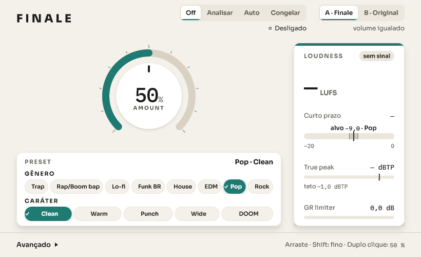
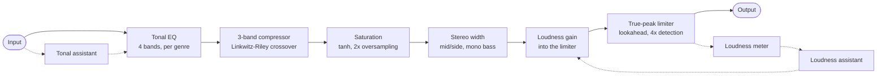
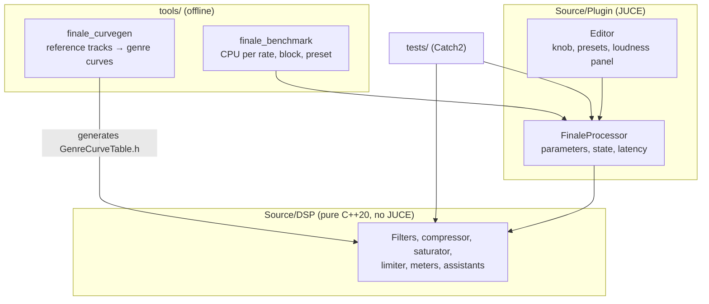

<h1 align="center">Finale</h1>

<p align="center">
  <b>One-knob mastering plugin with a built-in assistant that listens to the track.</b><br>
  VST3 + Standalone · Windows · C++20 · JUCE
</p>

<p align="center">
  
</p>

Finale is a mastering effect for the end of a music project. You pick a genre and a character, turn one knob, and the plugin takes the mix to industry loudness and tonal balance. An assistant measures the song (loudness, tonal balance, true peak) and adjusts the chain for you, so the knob stays simple while the processing underneath is a full mastering chain.

It is a side project by two developers under the Cremoland GitHub org, each working with their own Claude Code on the same repository. Internal docs, issues, PRs and commit messages are in Portuguese; code and identifiers are in English.

> **Status:** in active development (v0.1.0). Not released yet.

---

## Contents

- [What it does](#what-it-does)
- [Signal chain](#signal-chain)
- [Architecture](#architecture)
- [Quality and testing](#quality-and-testing)
- [Performance](#performance)
- [How the project is built](#how-the-project-is-built)
- [Build and run](#build-and-run)
- [Genre reference curves](#genre-reference-curves)
- [Repository map](#repository-map)

---

## What it does

| Feature | Details |
|---|---|
| **One knob** | `amount` goes from 0% (no processing) to 100% (full master at the preset's target). It drives the whole chain at once. |
| **Presets** | Genre (Trap, Rap/Boom bap, Lo-fi, Funk BR, House, EDM, Pop, Rock) × character (Clean, Warm, Punch, Wide, DOOM). |
| **Loudness assistant** | Three modes: **Analyze** (listen, then lock the settings), **Auto** (adapt slowly in real time, without pumping) and **Freeze** (keep the current Auto state for export). Targets are per genre (e.g. EDM −8.5 LUFS, Pop −9.5 LUFS), with an offset or a manual absolute target. |
| **Tonal assistant** | Measures the spectral shape of the incoming mix in 4 bands and nudges the tonal EQ toward a neutral commercial balance (up to ±6 dB per band), with the genre curve on top. |
| **Loudness metering** | ITU-R BS.1770 / EBU R128 meter: momentary, short-term and gated integrated LUFS, plus true peak. |
| **Level-matched A/B** | Compares the processed signal with the original, delayed to match latency and gain-matched by loudness, so "louder" never fools the ear. |
| **Safety ceiling** | Output never exceeds the true-peak ceiling (−1 dBTP by default). |

## Signal chain



The assistants are deterministic rules (measure → compare with target → adjust slowly), not machine learning. The tonal assistant measures *before* the EQ, so its correction never feeds back into its own measurement (open loop, no oscillation).

| Block | Implementation | Reference |
|---|---|---|
| Tonal EQ | Low shelf, 300 Hz peak, 3 kHz peak, high shelf | RBJ Audio EQ Cookbook |
| Crossover | 4th-order Linkwitz-Riley, allpass phase alignment for a flat sum | Linkwitz-Riley |
| Compressor | Feed-forward, 3 bands, stereo-linked, dB-domain peak detector | |
| Saturation | `tanh(g·x)/g` at 2x rate, 63-tap half-band FIR | Zölzer, *DAFX* ch. 4; Oppenheim & Schafer |
| Stereo width | Mid/side, side split at 120 Hz so the low end stays mono | Blumlein M/S |
| Limiter | Lookahead gain computed before the peak reaches the output | Signalsmith Audio limiter design |
| True peak | 4x interpolation, 48-tap windowed-sinc FIR | ITU-R BS.1770-4 (inspired) |
| Loudness | K-weighting + gated integration | ITU-R BS.1770-5, EBU Tech 3341 |

## Architecture



- **`Source/DSP/` has no JUCE dependency.** Every algorithm is plain C++ with the standard library, so it is unit-tested without opening a DAW. New algorithms always land here with tests.
- **`Source/Plugin/`** is the JUCE layer: parameters, saved state, latency reporting and the editor.
- **Real-time rules** for the audio thread: no allocation, locks, I/O or logging; parameters are read through `std::atomic` and smoothed to avoid clicks; any sample rate and block size must work, including 0- and 1-sample blocks; output is never NaN or infinite.
- **Backward compatibility:** parameter IDs are permanent, because users' saved projects depend on them. They are only ever added, never renamed or removed.

## Quality and testing

- **~180 Catch2 test cases** across 19 test files: every DSP block, the assistants, the genre-curve generator and an integration test of the full processor.
- **CI on every PR (GitHub Actions):**

  | Job | What it checks |
  |---|---|
  | `format` | `clang-format --dry-run --Werror` on all C++ sources (pinned to 22.1.8) |
  | `build` | Windows build (Visual Studio 2022, Release) |
  | DSP tests | `ctest` runs the full suite |
  | `pluginval` | Tracktion's plugin validator at strictness level 10 |
  | Artifact | Uploads the built VST3 and Standalone so anyone can test the PR in a DAW |

- A PR only merges with all checks green. Failing checks are fixed at the cause; tests are never skipped or relaxed to pass.

## Performance

Measured with `finale_benchmark` (i7-9750H, Release, amount at 100%):

| Sample rate | Full chain (one core) | p99 per block |
|---|---|---|
| 48 kHz | ≈ 3.7% | ≤ 7% |
| 96 kHz | ≈ 7.3% | ≤ 13% |

About half the cost is the saturator's 2x oversampling. A known next step, not needed yet, is to skip the half-band filter's zero taps, which cuts its multiplications by about two thirds.

## How the project is built

Two developers work in parallel, each with their own Claude Code, on the same repository. A shared [`CLAUDE.md`](CLAUDE.md) gives both agents the same rules, and the workflow is enforced in three places:

1. **Issue first.** Every task is an issue, and whoever takes it assigns themselves before starting.
2. **Plan, then build.** Larger features start with a written implementation plan in [`docs/superpowers/plans/`](docs/superpowers/plans/), and research notes go in [`docs/pesquisa/`](docs/pesquisa/) (e.g. loudness standards, per-genre targets).
3. **Small PRs from short branches.** One change per PR, hours of work rather than weeks, merged only with green CI.
4. **`main` is protected by convention and tooling:** [`.claude/settings.json`](.claude/settings.json) denies agents any push to `main` or force-push, and a local [`pre-push` hook](.githooks/pre-push) blocks it for humans too.
5. **Decisions are written down.** [`docs/decisoes.md`](docs/decisoes.md) is the single source of truth for product and technical decisions, with dates.

The UI went through the same process: nine HTML prototypes in [`docs/ui/prototipos/`](docs/ui/prototipos/) before the final design was built into the plugin.

## Build and run

**Requirements (Windows):** Visual Studio 2022 with *Desktop development with C++*, [CMake](https://cmake.org/download/) 3.22+, [Git](https://git-scm.com/), [GitHub CLI](https://cli.github.com/) and `pip install clang-format==22.1.8`.

After cloning, enable the hook that blocks direct pushes to `main`:

```
git config core.hooksPath .githooks
```

Build and test:

```
cmake -B build -G "Visual Studio 17 2022" -A x64
cmake --build build --config Release --parallel
ctest --test-dir build -C Release --output-on-failure
```

JUCE (9.0.3) and Catch2 are fetched by CMake at pinned versions.

**Try it in a DAW:** copy `build/finale_plugin_artefacts/Release/VST3/Finale.vst3` to `C:\Program Files\Common Files\VST3\` and rescan plugins. Every PR also publishes a ready-to-use build in the **Actions** tab.

**CPU benchmark:**

```
build\Release\finale_benchmark.exe
```

## Genre reference curves

`finale_curvegen` measures reference tracks per genre and regenerates `Source/DSP/GenreCurveTable.h`, a C++ header, so the plugin needs no parser at runtime.

Reference audio stays on each machine in a git-ignored `references/` folder, one subfolder per genre (commercial audio is never committed):

```
references/
  Trap/  Rap-Boom bap/  Lo-fi/  Funk BR/  House/  EDM/  Pop/  Rock/
```

- WAV, AIFF and FLAC (no MP3), at 32 kHz or higher. Files go directly in the genre folder.
- At least 2 genres need references. The references set the *differences* between genres (capped at ±6 dB); the shared bias is the per-band mean of the current table over the measured genres, so it can still be tuned by ear.

From the repository root:

```
build\finale_curvegen_artefacts\Release\finale_curvegen.exe
```

The header is rewritten only if something changed; then rebuild the plugin. Custom paths: `finale_curvegen <referencesFolder> <outputFile>`.

## Repository map

```
Source/DSP/        Pure C++ audio processing (filters, dynamics, meters, assistants)
Source/Plugin/     JUCE integration: processor, parameters, state, editor, theme
tests/             Catch2 unit tests and processor integration test
tools/curvegen/    Offline genre-curve generator
tools/benchmark/   CPU benchmark of the full processor
docs/decisoes.md   Product and technical decisions (source of truth)
docs/superpowers/  Implementation plans per feature
docs/pesquisa/     Research notes (loudness, genre targets, UI references)
docs/ui/           UI prototypes and previews
.github/           CI workflow, issue and PR templates
CLAUDE.md          Rules shared by both developers and their Claude Code agents
```
